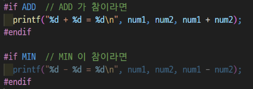
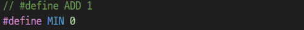
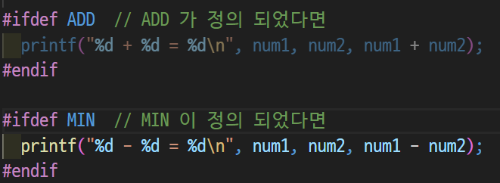
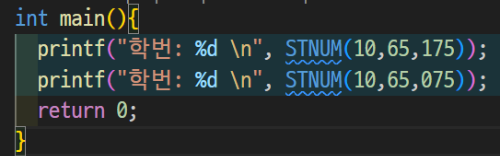

#### 1. 선행처리

  - [[컴파일]] 이전의 처리

  - #으로 표현

```cpp
#include <stdio.h>  // stdio.h 헤더 
#define PI 3.14  // 매크로 상수
```

  - PI 를 모두 3.14로 치환

  - 매크로의 이름은 대문자로 정의하는 것이 일반적이다

```cpp
#include <stdio.h>

#define PRINT_ADDR   puts("주소: 경기도 용인시\n);
// 함수 호출문도 정의 가능
```

 

  - [[매개 변수]]가 존재하는 매크로

```cpp
#define SQUARE(X)  X*X

int main(){
  printf("Square of 3+2: %d\n", SQUARE(3+2));
  // 11 출력 // 3+2*3+2 계산
```

  - 매크로 몸체에 괄호를 사용해야 함!

```cpp
#define SQUARE(X) ( (X) * (X) )
```

 

  - 매크로를 두 줄 이상에 걸쳐 정의하기

```cpp
#define SQUARE(X)    \
		((X) * (X))
```

 

  - 매크로 정의 시, 앞서 정의된 매크로 사용 가능

```cpp
#include <stdio.h>
#define PI 3.14
#define PRODUCT(X, Y)  ((X)*(Y))
#define CIRCLE_AREA(R) (PRODUCT((R)*(R))*PI)
```

 

<table>
<tbody>
<tr>
<td>장점</td>
<td>단점</td>
</tr>
<tr>
<td>실행 속도가 빠르다</td>
<td>정의하기 까다롭다</td>
</tr>
<tr>
<td>자료형에 구애받지 않는다</td>
<td>디버깅하기 어렵다</td>
</tr>
</tbody>
</table>

  - 작은 크기의 함수, 호출 빈도 높은 함수 매크로 정의!

---

#### 2. 조건부 컴파일 매크로

\#if / #endif : 참 거짓 기준

```cpp
#include <stdio.h>
#define ADD 1
#define MIN 0

int main(){
  int num1, num2;
  printf("두 개의 정수 입력: ");
  scanf("%d %d", &num1, &num2);

#if ADD  // ADD 가 참이라면
  printf("%d + %d = %d\n", num1, num2, num1 + num2);
#endif

#if MIN  // MIN 이 참이라면
  printf("%d - %d = %d\n", num1, num2, num1 - num2);  // 거짓이므로 삭제
#endif
```

 

  - #if 코드 시작 #endif 코드 끝

  - if 조건이 참이면 코드 삽입. 거짓이면 코드 삭제



 

\#ifdef / #endif : 정의 기준

  - if 조건이 정의되었으면 코드 삽입. 정의 안되었으면 코드 삭제



  - 값은 중요하지 않다. 몸체 생략 정의 가능

  - 단, 소스 코드에 있는 매크로가 선행처리 과정에서 공백으로 대체 됨(소멸됨)

```cpp
#define ADD  // 정의 O
```

 

\#ifndef / #endif : 정의되어 있지 않으면 참

  - 헤더파일의 중복포함을 막기 위해 사용

 

\#else 문 : #if, #ifdef, #ifndef 모두 사용 가능

\#elif 문 : #if 문에만 사용 가능. 여러 번 사용가능

---

#### 3. 매개변수의 결합과 문자열화

  - #연산자 : 문자열 내에서 매크로의 매개변수 치환

```cpp
#define STR(ABC)   #ABC
//매개변수 ABC에 전달되는 인자를 문자열 "ABC"로 치환해라

int main(){
  STR(12,23,34);  // "12,23,34"
  
  char * str=STR(12) STR(34);
  char * str="1234";  // 윗 문장과 동일한 선언
```

  - 문자열 나란히 선언시 하나의 문자열로 간주

 

  - ##연산자 : 필요한 형태대로 순서대로 결합

  - 무엇이 전달되든 단순히 연결

```cpp
#define STNUM(Y, S, P) Y ## S ## P
```


