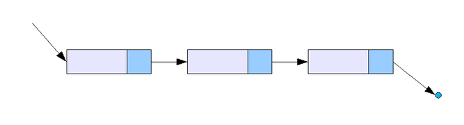
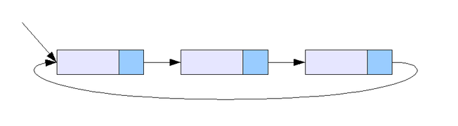
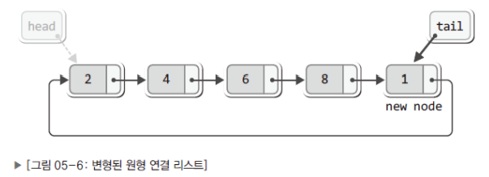
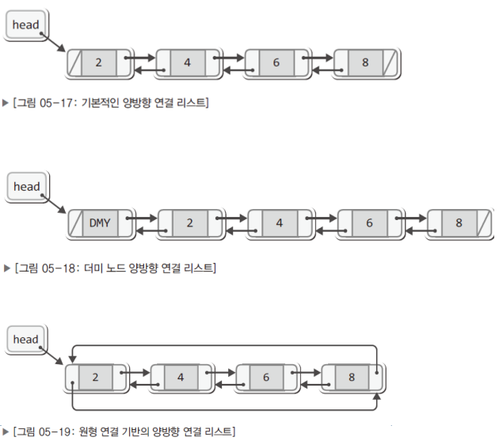

### 1. 연결 리스트 ADT

  - 연결 리스트 : 필요할 때마다 구조체 변수를 동적 할당하여 이들을 연결



  - 리스트의 ADT + 정렬 기능

```cpp
void SetSortRule(List *plist, int (*comp)(LData d1, LData d2));
```

  - 리스트에 정렬의 기준이 되는 함수 등록

 

  - 새 노드를 추가할 때, 리스트의 머리와 꼬리 중 어디에 저장할 것인가?

<table>
<tbody>
<tr>
<td> </td>
<td>머리에 추가</td>
<td>꼬리에 추가</td>
</tr>
<tr>
<td>장점</td>
<td>포인터 변수 tail 불필요</td>
<td>저장된 순서 유지</td>
</tr>
<tr>
<td>단점</td>
<td>저장된 순서 유지 X</td>
<td>포인터 변수 tail 필요</td>
</tr>
</tbody>
</table>

  - 구현에서는 머리에 추가하는 방법 선호. 리스트 자료구조는 저장된 순서를 유지해야 하는 자료구조 X

---

### 2. 단순 연결 리스트

  - 더미 노드를 이용한 구현

  - DLinkedList.h 

```cpp
#ifndef __D_LINKED_LIST_H
#define __D_LINKED_LIST_H

#define TRUE   1
#define FALSE  0

typedef int LData;

typedef struct _node{
  LData data;
  struct _node * next;
} Node;

typedef struct _linkedList{
  Node * head;
  Node * cur;
  Node * before;
  int numOfData;
  int (*comp)(LData d1, LData d2);
} LinkedList;

typedef LinkedList List;

void ListInit(List * plist);
void LInsert(List * plist, LData data);

int LFirst(List * plist, LData * pdata);
int LNext(List * plist, LData * pdata);

LData LRemove(List * plist);
int LCount(List * plist);

void SetSortRule(List * plist, int (*comp)(LData d1, LData d2));  
// 연결 리스트의 정렬 기준이 되는 함수 등록

#endif
```

 

  - DLinkedList.c

```cpp
#include <stdio.h>
#include <stdlib.h>
#include "DLinkedList.h"

void ListInit(List * plist){
  plist->head = (Node*)malloc(sizeof(Node));  // 더미 노드의 생성
  plist->head->next = NULL;
  plist->comp = NULL;
  plist->numOfData = 0;
}

void FInsert(List * plist, LData data){    // comp 가 NULL일 때 호출
  Node * newNode = (Node*)malloc(sizeof(Node));   // 새 노드 생성
  newNode->data = data;                           // 새 노드에 데이터 저장

  newNode->next = plist->head->next;              // 새 노드가 다른 노드를 가리키게 함
  plist->head->next = newNode;                    // 더미 노드가 새 노드를 가리키게 함

  (plist->numOfData)++;                           // 저장된 노드의 수를 하나 증가시킴
}

void SInsert(List * plist, LData data){
  Node * newNode = (Node*)malloc(sizeof(Node));   // 새 노드 생성
  Node * pred = plist->head;                      // pred는 더미 노드를 가리킴

  newNode->data = data;                           // 새 노드에 데이터 저장

  // 새 노드의 위치를 찾기 위한 반복문
  while(pred->next != NULL && plist->comp(data, pred->next->data) != 0){
    // pred가 마지막 노드가 아니고
    // 비교함수를 통한 정렬 순서에 일치하지 않으면
    pred = pred->next;  // 다음 노드로 이동
  }

  newNode->next = pred->next;                     // 새 노드의 오른쪽을 연결
  pred->next = newNode;                           // 새 노드의 왼쪽을 연결

  (plist->numOfData)++;                           // 저장된 노드의 수를 하나 증가시킴
}

void LInsert(List * plist, LData data){
  if(plist->comp == NULL)  // 정렬 기준이 마련되지 않았다면
    FInsert(plist, data);  // 머리에 노드를 추가
  else                     // 정렬 기준이 마련되었다면
    SInsert(plist, data);  // 정렬 기준에 근거하여 노드를 추가
}

int LFirst(List * plist, LData * pdata){
  if(plist->head->next == NULL)   // 더미 노드가 NULL을 가리킨다면,
    return FALSE;                 // 반환할 데이터가 없다
  
  plist->before = plist->head;    // before은 더미 노드를 가리키게 함
  plist->cur = plist->head->next; // cur은 첫 번째 노드를 가리키게 함

  *pdata = plist->cur->data;      // 첫 번째 노드의 데이터를 전달
  return TRUE;                    // 데이터 반환 성공!
}

int LNext(List * plist, LData * pdata){
  if(plist->cur->next == NULL)    // cur이 NULL을 가리킨다면
    return FALSE;                 // 반환할 데이터가 없다

  plist->before = plist->cur;     // before은 cur이 가리키던 노드를 가리키게 함
  plist->cur = plist->cur->next;  // cur은 다음 노드를 가리키게 함

  *pdata = plist->cur->data;      // cur이 가리키는 노드의 데이터 전달
  return TRUE;                    // 데이터 반환 성공!
}

int LRemove(List * plist){   // cur과 before가 가리키는 노드가 같게 됨!
  Node * rpos = plist->cur;  // 소멸 대상의 주소 값을 rpos에 저장
  LData rdata = rpos->data;  // 소멸 대상의 데이터를 rdata에 저장

  plist->before->next = plist->cur->next;  // 소멸 대상을 리스트에서 제거
  plist->cur = plist->before;              // cur이 가리키는 위치를 재조정

  free(rpos);            // 소멸 대상의 메모리 해제
  (plist->numOfData)--;  // 저장된 데이터의 수 하나 감소
  return rdata;          // 제거된 데이터 반환
}

int LCount(List * plist){
  return plist->numOfData;
}

void SetSortRule(List * plist, int (*comp)(LData d1, LData d2)){
  plist->comp = comp;  // 정렬 함수 등록
}

/* 우선 순위 비교를 위한 함수 comp(data1, data2) */
// comp가 0을 반환 시 
// comp가 1을 반환 시
```

  - 데이터 삭제 시 주의할 점

  1) 삭제할 노드의 이전 노드가, 삭제할 노드의 다음 노드를 가리키게 한다

  2) 포인터 변수 cur을 한 칸 뒤로 이동시킨다

 

---

### 3. 원형 연결 리스트



  - 마지막 노드가 첫 번째 노드를 가리켜, 연결의 형태가 원을 이루는 구조

 

  - 변형된 원형 연결 리스트



  - 꼬리를 가리키는 포인터 변수 : tail

  - 머리를 가리키는 포인터 변수 : tail->next

 

  - CLinkedList.h

```cpp
#ifndef __C_LINKED_LIST_H
#define __C_LINKED_LIST_H

#define TRUE   1
#define FALSE  0

typedef int Data;

typedef struct _node{
  Data data;
  struct _node * next;
} Node;

typedef struct _CLL{
  Node * tail;
  Node * cur;
  Node * before;
  int numOfData;
} CList;

typedef CList List;

void ListInit(List * plist);
void LInsert(List * plist, Data data);       // 꼬리에 노드를 추가
void LInsertFront(List * plist, Data data);  // 머리에 노드를 추가

int LFirst(List * plist, Data * pdata);
int LNext(List * plist, Data * pdata);
Data LRemove(List * plist);
int LCount(List * plist);

#endif
```

 

  - CLinkedList.c

```cpp
#include <stdio.h>
#include <stdlib.h>
#include "CLinkedList.h"

void ListInit(List * plist){
  plist->tail = NULL;
  plist->cur = NULL;
  plist->before = NULL;
  plist->numOfData = 0;
}

void LInsertFront(List * plist, Data data){  // 머리 추가 tail은 그대로
  Node * newNode = (Node*)malloc(sizeof(Node));
  newNode->data = data;

  if(plist->tail == NULL){
    plist->tail = newNode;
    newNode->next = newNode;
  }else{
    newNode->next = plist->tail->next;  // 새 노드와 기존 노드 연결
    plist->tail->next = newNode;        // tail이 새 노드를 가리키게 함
  }
  (plist->numOfData)++;
}

void LInsert(List * plist, Data data){       // 꼬리 추가
  Node * newNode = (Node*)malloc(sizeof(Node));
  newNode->data = data;

  if(plist->tail == NULL){
    plist->tail = newNode;
    newNode->next = newNode;
  }else{
    newNode->next = plist->tail->next;  // 머리 일치 시키기
    plist->tail->next = newNode;
    plist->tail = newNode;  // LInsertFront와 다른 부분
  }
  (plist->numOfData)++;
}

int LFirst(List * plist, Data * pdata){
  if(plist->tail == NULL){         // 저장된 노드가 없다면
    return FALSE;
  }
  plist->before = plist->tail;     // before가 꼬리를 가리키게 한다
  plist->cur = plist->tail->next;  // cur이 머리를 가리키게 한다

  *pdata = plist->cur->data;       // cur이 가리키는 노드의 데이터 반환
  return TRUE;
}

int LNext(List * plist, Data * pdata){
  if(plist->tail == NULL){         // 저장된 노드가 없다면
    return FALSE;
  }
  plist->before = plist->cur;      // before가 머리를 가리키게 한다
  plist->cur = plist->cur->next;   // cur이 다음 노드를 가리키게 한다

  *pdata = plist->cur->data;       // cur이 가리키는 노드의 데이터 반환
  return TRUE;
}
// 리스트 끝 검사 코드 X 
// 무한으로 반복해서 호출 가능

Data LRemove(List * plist){
  Node * rpos = plist->cur;
  Data rdata = rpos->data;

  if(rpos == plist->tail){                 // 삭제 대상을 tail이 가리킨다면
    if(plist->tail == plist->tail->next){  // 그리고 마지막 노드라면
      plist->tail = NULL;
    }else{
      plist->tail = plist->before;
    }
  }
  plist->before->next = plist->cur->next;
  plist->cur = plist->before;

  free(rpos);
  (plist->numOfData)--;
  return rdata;
}

/* 삭제 시 예외 사항*/
// 1) 삭제할 노드를 tail이 가리키는 경우
// 2) 삭제할 노드가 리스트에 홀로 남은 경우
```

---

### 4. 이중 연결 리스트



 

1\) 기본적 양방향 연결 리스트

  - DBLinkedList.h

```cpp
#ifndef __DB_LINKED_LIST_H__
#define __DB_LINKED_LIST_H__

#define TRUE  1
#define FALSE 0

typedef int Data;

typedef struct _node{
  Data data;
  struct _node * next;
  struct _node * prev;
} Node;

typedef struct _DBLinkedList{
  Node * head;
  Node * cur;
  int numOfData;
} DBLinkedList;

typedef DBLinkedList List;

void ListInit(List * plist);
void LInsert(List * plist, Data data);

int LFirst(List * plist, Data * pdata);
int LNext(List * plist, Data * pdata);
int LPrevious(List * plist, Data * pdata);
int LCount(List * plist);

#endif
```

 

  - DBLinkedList.c

```cpp
#include <stdio.h>
#include <stdlib.h>
#include "DBLinkedList.h"

void ListInit(List * plist){
  plist->head = NULL;
  plist->numOfData = 0;
}

void LInsert(List * plist, Data data){
  Node * newNode = (Node*)malloc(sizeof(Node));
  newNode->data = data;
  
  newNode->next = plist->head;     // 새 노드의 next를 NULL로 초기화(1) // 새 노드가 기존 노드를 가리키게 한다
  if(plist->head != NULL)          // 두 번째 이상일 경우
    plist->head->prev = newNode;   // 기존 노드가 새 노드를 가리키게 한다
  newNode->prev = NULL;            // 새 노드의 prev를 NULL로 초기화(첫 번째 노드일 경우만 해당)
  plist->head = newNode;           

  (plist->numOfData)++;
}

int LFirst(List * plist, Data * pdata){  // 첫 번째 노드의 데이터 조회
  if(plist->head == NULL)
    return FALSE;

  plist->cur = plist->head;   // cur이 첫 번째 노드를 가리키게 함
  *pdata = plist->cur->data;  // cur이 가리키는 노드의 데이터 전달
  return TRUE;
}

int LNext(List * plist, Data * pdata){  // 두 번째 이후 노드의 데이터 조회
  if(plist->cur->next == NULL)
    return FALSE;

  plist->cur = plist->cur->next;  // cur을 오른쪽으로 이동
  *pdata = plist->cur->data;      // cur이 가리키는 노드의 데이터 전달
  return TRUE;
}

int LPrevious(List * plist, Data * pdata){  // 반대 방향(왼쪽) 노드의 데이터 조회
  if(plist->cur->prev == NULL)
    return FALSE;

  plist->cur = plist->cur->prev;  // cur을 왼쪽으로 이동
  *pdata = plist->cur->data;      // cur이 가리키는 노드의 데이터 전달
  return TRUE;
}

int LCount(List * plist){
  return plist->numOfData;
}
```

 

 

2\) 더미 노드 양방향 리스트

  - DBDLinkedList.h

```cpp
#ifndef __DBD_LINKED_LIST_H__
#define __DBD_LINKED_LIST_H__

#define TRUE  1
#define FALSE 0

typedef int Data;

typedef struct _node{
  Data data;
  struct _node * next;
  struct _node * prev;
} Node;

typedef struct _DBDLinkedList{
  Node * head;
  Node * tail;
  Node * cur;
  int numOfData;
} DBDLinkedList;

typedef DBDLinkedList List;

void ListInit(List * plist);
void LInsert(List * plist, Data data);  // 꼬리에 노드를 추가한다

int LFirst(List * plist, Data * pdata);
int LNext(List * plist, Data * pdata);

Data LRemove(List * plist);  // 앞서 참조가 이뤄진 노드를 삭제
int LCount(List * plist);

#endif
```

 

 

  - DBDLinkedList.c

```cpp
#include <stdio.h>
#include <stdlib.h>
#include "DBDLinkedList.h"

void ListInit(List * plist){
  plist->head = (Node*)malloc(sizeof(Node));  // 머리 더미 노드 생성
  plist->tail = (Node*)malloc(sizeof(Node));  // 꼬리 더미 노드 생성

  plist->head->prev = NULL;  // 머리 더미 노드의 prev는 NULL
  plist->head->next = plist->tail;  // 머리 더미 노드의 next는 꼬리 더미 노드

  plist->tail->next = NULL;  // 꼬리 더미 노드의 next는 NULL
  plist->tail->prev = plist->head;  // 꼬리 더미 노드의 prev는 머리 더미 노드

  plist->numOfData = 0;
}

void LInsert(List * plist, Data data){
  Node * newNode = (Node*)malloc(sizeof(Node));
  newNode->data = data;

  newNode->prev = plist->tail->prev;  // 새 노드의 prev는 꼬리 더미 노드의 prev
  plist->tail->prev->next = newNode;  // 꼬리 더미 노드의 prev가 새 노드를 가리키게 함

  newNode->next = plist->tail;  // 새 노드의 next는 꼬리 더미 노드
  plist->tail->prev = newNode;  // 꼬리 더미 노드의 prev는 새 노드를 가리키게 함

  (plist->numOfData)++;
}

int LFirst(List * plist, Data * pdata){
  if(plist->head->next == plist->tail)  // 머리 더미 노드의 next가 꼬리 더미 노드인 경우
    return FALSE;  // 데이터가 없다

  plist->cur = plist->head->next;  // cur이 첫 번째 노드를 가리키게 함
  *pdata = plist->cur->data;  // cur이 가리키는 노드의 데이터 전달
  return TRUE;
}

int LNext(List * plist, Data * pdata){
  if(plist->cur->next == plist->tail)  // cur이 꼬리 더미 노드인 경우
    return FALSE;  // 데이터가 없다

  plist->cur = plist->cur->next;  // cur을 오른쪽으로 이동
  *pdata = plist->cur->data;  // cur이 가리키는 노드의 데이터 전달
  return TRUE;
}

Data LRemove(List * plist){
  Node * rpos = plist->cur;  // 삭제 대상 지정
  Data rdata = rpos->data;  // 삭제 대상의 데이터 백업

  plist->cur->prev->next = plist->cur->next;  // 삭제 대상을 건너뛰고 이전 노드와 다음 노드를 연결
  plist->cur->next->prev = plist->cur->prev;  // 삭제 대상을 건너뛰고 다음 노드와 이전 노드를 연결
  plist->cur = plist->cur->prev;  // cur이 삭제 대상의 이전 노드를 가리키게 함

  free(rpos);  // 삭제 대상 소멸
  (plist->numOfData)--;  // 저장된 데이터의 수 하나 감소
  return rdata;  // 삭제된 데이터 반환
}

int LCount(List * plist){
  return plist->numOfData;
}
```
