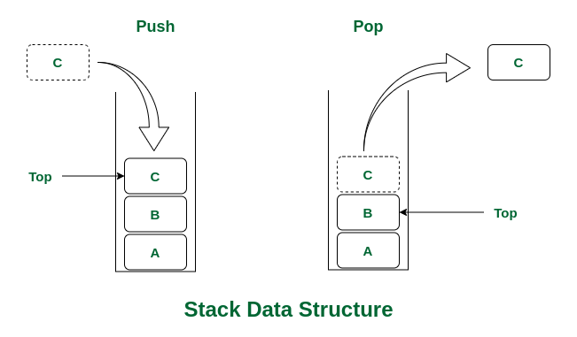

### 1. 스택 ADT

  - 스택 : 나중에 들어간 것이 먼저 나오는 구조. 



 

<mark>Operations:</mark>

 

```cpp
void StackInit(Stack * pstack);
```

  - 스택의 초기화 진행

  - 스택 생성 후 가장 먼저 호출

 

```cpp
int SIsEmpty(Stack * pstack);
```

  - 스택이 빈 경우 TRUE(1), 그렇지 않은 경우 FALSE(0) 반환

 

```cpp
void SPush(Stack * pstack, Data data);
```

  - 스택에 데이터 저장. 매개변수 data로 전달된 값 저장

 

```cpp
Data SPop(Stack * pstack);
```

  - 마지막에 저장된 요소 삭제, 삭제된 데이터 반환

  - 데이터가 하나 이상 존재함이 보장되어야 함.

 

```cpp
Data SPeek(Stack * pstack);
```

  - 마지막에 저장된 요소 반환 O 삭제 X

  - 데이터가 하나 이상 존재함이 보장되어야 함.

---

### 2. 배열 기반 스택 구현 

  -  인덱스 0의 배열 요소가 스택의 바닥

  - 마지막에 저장된 데이터 위치 기억

  - 입력된 데이터가 역순으로 출력!

  

  - ArrayBaseStack.h

```cpp
#ifndef __AB_STACK_H
#define __AB_STACK_H

#define TRUE   1
#define FALSE  0
#define STACK_LEN 100

typedef int Data;

typedef struct _arrayStack{
  Data stackArr[STACK_LEN];
  int topIndex;
} ArrayStack;

typedef ArrayStack Stack;

void StackInit(Stack * pstack);  // 스택의 초기화
int SIsEmpty(Stack * pstack);    // 스택이 비었는지 확인

void SPush(Stack * pstack, Data data);  // 스택의 push 연산
Data SPop(Stack * pstack);               // 스택의 pop 연산
Data SPeek(Stack * pstack);              // 스택의 peek 연산

#endif
```

 

  - ArrayBaseStack.c

```cpp
#include <stdio.h>
#include <stdlib.h>
#include "ArrayBaseStack.h"

void StackInit(Stack * pstack){
  pstack->topIndex = -1;  // topIndex의 -1은 빈 스택을 의미
}

int SIsEmpty(Stack * pstack){
  if(pstack->topIndex == -1)  // 스택이 비어있다면
    return TRUE;
  else
    return FALSE;
}

void SPush(Stack * pstack, Data data){  // 스택의 push 연산
  ++(pstack->topIndex);  // 데이터 추가를 위한 인덱스 값 증가
  pstack->stackArr[pstack->topIndex] = data;  // 데이터 저장
}

Data SPop(Stack * pstack){  // 스택의 pop 연산
  int rIdx;

  if(SIsEmpty(pstack)){
    printf("Stack Memory Error!");
    exit(-1);
  }

  rIdx = pstack->topIndex;  // 삭제할 데이터의 인덱스 저장
  --(pstack->topIndex);     // 인덱스 값 감소
  return pstack->stackArr[rIdx];  // 삭제된 데이터 반환
}

Data SPeek(Stack * pstack){  // 스택의 peek 연산
  if(SIsEmpty(pstack)){
    printf("Stack Memory Error!");
    exit(-1);
  }

  return pstack->stackArr[pstack->topIndex];  // topIndex가 가리키는 데이터 반환
}
```

---

### 3. 연결 리스트 기반 스택 구현

  - ListBaseStack.h

```cpp
#ifndef __LB_STACK_H__
#define __LB_STACK_H__

#define TRUE  1
#define FALSE 0

typedef int Data;

typedef struct _node{  // 연결 리스트의 노드를 표현
  Data data;
  struct _node * next;
} Node;

typedef struct _listStack{  // 연결 리스트 기반 스택을 표현한 구조체
  Node * head;
} ListStack;

typedef ListStack Stack;

void StackInit(Stack * pstack);  // 스택의 초기화
int SIsEmpty(Stack * pstack);    // 스택이 비었는지 확인

void SPush(Stack * pstack, Data data);  // 스택의 push 연산
Data SPop(Stack * pstack);              // 스택의 pop 연산
Data SPeek(Stack * pstack);             // 스택의 peek 연산

#endif
```

 

  - ListBaseStack.c

```cpp
#include <stdio.h>
#include <stdlib.h>
#include "ListBaseStack.h"

void StackInit(Stack * pstack){
  pstack->head = NULL;  // 포인터 변수 head를 NULL로 초기화
}

int SIsEmpty(Stack * pstack){
  if(pstack->head == NULL)  // 스택이 비어있으면 head는 NULL
    return TRUE;
  else
    return FALSE;
}

void SPush(Stack * pstack, Data data){
  Node * newNode = (Node*)malloc(sizeof(Node));  // 새 노드 생성
  newNode->data = data;  // 새 노드에 데이터 저장

  newNode->next = pstack->head;  // 새 노드가 기존의 헤드가 가리키던 노드를 가리키게 함
  pstack->head = newNode;  // 헤드가 새 노드를 가리키게 함
}

Data SPop(Stack * pstack){
  Data rdata;
  Node * rnode;

  if(SIsEmpty(pstack)){
    printf("Stack Memory Error!");
    exit(-1);
  }

  rdata = pstack->head->data;  // 삭제할 데이터 저장
  rnode = pstack->head;        // 삭제할 노드의 주소 값 저장
  pstack->head = pstack->head->next;  // 삭제할 노드의 다음 노드를 head로 지정
  free(rnode);  // 첫 번째 노드의 메모리 해제
  return rdata;  // 삭제된 데이터 반환
}

Data SPeek(Stack * pstack){
  if(SIsEmpty(pstack)){
    printf("Stack Memory Error!");
    exit(-1);
  }

  return pstack->head->data;  // head가 가리키는 노드의 데이터 반환
}
```

###  
