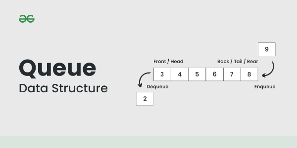

### 1. 큐 ADT

  - 큐 : 먼저 들어간 데이터가 먼저 나오는 구조



 

<mark>Operations:</mark>

 

```cpp
void QueueInit(Queue * pq);
```

  - 큐의 초기화 진행

  - 큐 생성 후 가장 먼저 호출

 

```cpp
int QIsEmpty(Queue * pq);
```

  - 큐가 빈 경우 TRUE(1), 그렇지 않은 경우 FALSE(0) 반환

 

```cpp
void Enqueue(Queue * pq, Data data);
```

  - 큐에 데이터 저장

 

```cpp
Data Dequeue(Queue * pq);
```

  - 저장 순서가 가장 앞선 데이터 삭제, 삭제된 데이터 반환

  - 데이터가 하나 이상 존재함이 보장되어야 함.

 

```cpp
Data QPeek(Queue * pq);
```

  - 저장 순서가 가장 앞선 데이터 반환 O, 삭제 X

  - 데이터가 하나 이상 존재함이 보장되어야 함.

---

### 2. 배열 기반 큐 구현 : 원형 큐

  - 원형 큐가 텅 빈 상태 : F(Front)와 R(Rear)이 동일한 위치를 가리킴

  - 원형 큐가 꽉 찬 상태 : R이 가리키는 위치의 앞을 F가 가리킴

 

  - CircularQueue.h

```cpp
#ifndef __C_QUEUE_H__
#define __C_QUEUE_H__

#define TRUE  1
#define FALSE 0

#define QUE_LEN 100
typedef int Data;

typedef struct _cQueue{
  int front;   // F
  int rear;    // R
  Data queArr[QUE_LEN];
} CQueue;

typedef CQueue Queue;

void QueueInit(Queue *pq);
int QIsEmpty(Queue *pq);

void Enqueue(Queue *pq, Data data);
Data Dequeue(Queue *pq);
Data QPeek(Queue *pq);

#endif
```

 

  - CircularQueue.c

```cpp
#include <stdio.h>
#include <stdlib.h>
#include "CircularQueue.h"

void QueueInit(Queue *pq){  // 텅 빈 경우 front 와 rear 는 같은 위치를 가리킴
  pq->front=0;
  pq->rear=0;
}

int QIsEmpty(Queue *pq){    // 큐가 비어있는지 확인
  if(pq->front==pq->rear)
    return TRUE;
  else
    return FALSE;
}

int NextPosIdx(int pos){
  if(pos == QUE_LEN-1)  // 배열의 마지막 요소의 인덱스 값이라면
    return 0;
  else
    return pos+1;
}

void Enqueue(Queue *pq, Data data){
  if(NextPosIdx(pq->rear)==pq->front){  // 큐가 꽉 찼다면
    printf("Queue Memory Error!\n");
    exit(-1);
  }

  pq->rear=NextPosIdx(pq->rear);  // rear 를 한 칸 이동
  pq->queArr[pq->rear]=data;       // rear 가 가리키는 곳에 데이터 저장
}

Data Dequeue(Queue *pq){
  if(QIsEmpty(pq)){  // 큐가 비어있다면
    printf("Queue Memory Error!\n");
    exit(-1);
  }

  pq->front=NextPosIdx(pq->front);  // front 를 한 칸 이동
  return pq->queArr[pq->front];      // front 가 가리키는 데이터 반환
}

Data QPeek(Queue *pq){
  if(QIsEmpty(pq)){  // 큐가 비어있다면
    printf("Queue Memory Error!\n");
    exit(-1);
  }

  return pq->queArr[NextPosIdx(pq->front)];  // front 가 가리키는 데이터 반환
}
```

---

### 3. 연결 리스트 기반 큐 구현

  - ListBaseQueue.h

```cpp
#ifndef __LB_QUEUE_H__
#define __LB_QUEUE_H__

#define TRUE  1
#define FALSE 0

typedef int Data;

typedef struct _node{
  Data data;
  struct _node *next;
} Node;

typedef struct _lQueue{
  Node *front;
  Node *rear;
} LQueue;

typedef LQueue Queue;

void QueueInit(Queue *pq);
int QIsEmpty(Queue *pq);

void Enqueue(Queue *pq, Data data);
Data Dequeue(Queue *pq);
Data QPeek(Queue *pq);

#endif
```

 

  - ListBaseQueue.c

```cpp
#include <stdio.h>
#include <stdlib.h>
#include "ListBaseQueue.h"

void QueueInit(Queue *pq){
  pq->front = NULL;
  pq->rear = NULL;
}

int QIsEmpty(Queue *pq){
  if(pq->front == NULL)  // front 가 NULL 이면 비어있는 상태
    return TRUE;
  else
    return FALSE;
}

void Enqueue(Queue *pq, Data data){
  Node *newNode = (Node*)malloc(sizeof(Node));
  newNode->data = data;
  newNode->next = NULL;

  if(QIsEmpty(pq)){  // 첫 번째 노드인 경우
    pq->front = newNode;  // front 와 rear 모두 새 노드를 가리키게 함
    pq->rear = newNode;
  }
  else{  // 두 번째 이후의 노드인 경우
    pq->rear->next = newNode;  // 마지막 노드의 다음을 새 노드로 설정
    pq->rear = newNode;  // rear 를 새 노드로 이동
  }
}

Data Dequeue(Queue *pq){
  if(QIsEmpty(pq)){
    printf("Queue Memory Error!\n");
    exit(-1);
  }

  Node *delNode = pq->front;     // 삭제 노드 주소 저장
  Data retData = delNode->data;  // 삭제 노드 값 저장

  pq->front = pq->front->next;   // front 를 다음 노드로 이동

  free(delNode);
  return retData;
}

Data QPeek(Queue *pq){
  if(QIsEmpty(pq)){
    printf("Queue Memory Error!\n");
    exit(-1);
  }

  return pq->front->data;
}
```

---

### 4. 덱 ADT와 구현

  - 덱 : 앞, 뒤 구분 없이 넣고 뺄 수 있는 [[Data Structure|자료구조]]

  - 양방향 [[Linked List|연결 리스트]] 기반

 

<mark>Operation: </mark>

 

```cpp
void DequeInit(Deque * pdeq);
```

  - 덱의 초기화 진행

  - 덱 생성 후 가장 먼저 호출

 

```cpp
int DQIsEmpty(Deque * pdeq);
```

  - 덱이 빈 경우 TRUE(1), 그렇지 않은 경우 FALSE(0) 반환

 

```cpp
void DQAddFirst(Deque * pdeq, Data data);
```

  - 덱의 머리에 데이터 저장

 

```cpp
void DQAddLast(Deque * pdeq, Data data);
```

  - 덱의 꼬리에 데이터 저장

 

```cpp
Data DQRemoveFirst(Deque * pdeq);
```

  - 덱의 머리 위치 데이터 반환 및 삭제

 

```cpp
Data DQRemoveLast(Deque * pdeq);
```

  - 덱의 꼬리 위치 데이터 반환 및 삭제

 

```cpp
Data DQGetFirst(Deque * pdeq);
```

  - 덱의 머리 위치 데이터 반환 O, 삭제 X

 

```cpp
Data DQGetLast(Deque * pdeq);
```

  - 덱의 꼬리 위치 데이터 반환 O, 삭제 X

 

  - [[Deque]].h

```cpp
#ifndef __DEQUE_H__
#define __DEQUE_H__

#define TRUE  1
#define FALSE 0

typedef int Data;

typedef struct _node{
  Data data;
  struct _node *next;
  struct _node *prev;
} Node;

typedef struct _dlDeque{
  Node *head;
  Node *tail;
} DLDeque;

typedef DLDeque Deque;

void DequeInit(Deque *pdeq);
int DQIsEmpty(Deque *pdeq);

void DQAddFirst(Deque *pdeq, Data data);  // 덱의 머리에 데이터 저장
void DQAddLast(Deque *pdeq, Data data);   // 덱의 꼬리에 데이터 저장

Data DQRemoveFirst(Deque *pdeq);  // 덱의 머리에서 데이터 삭제
Data DQRemoveLast(Deque *pdeq);   // 덱의 꼬리에서 데이터 삭제

Data DQGetFirst(Deque *pdeq);  // 덱의 머리에서 데이터 참조
Data DQGetLast(Deque *pdeq);   // 덱의 꼬리에서 데이터 참조

#endif
```

 

  - Deque.c

```cpp
#include <stdio.h>
#include <stdlib.h>
#include "Deque.h"

void DequeInit(Deque *pdeq){
  pdeq->head = NULL;
  pdeq->tail = NULL;
}

int DQIsEmpty(Deque *pdeq){
  if(pdeq->head == NULL)  // head 가 NULL 이면 덱이 비어있는 상태
    return TRUE;
  else
    return FALSE;
}

void DQAddFirst(Deque *pdeq, Data data){
  Node *newNode = (Node*)malloc(sizeof(Node));
  newNode->data = data;

  newNode->next = pdeq->head;

  if(DQIsEmpty(pdeq))  // 덱이 비어있다면
    pdeq->tail = newNode;
  else
    pdeq->head->prev = newNode;

  newNode->prev = NULL;
  pdeq->head = newNode;
}

void DQAddLast(Deque *pdeq, Data data){
  Node *newNode = (Node*)malloc(sizeof(Node));
  newNode->data = data;

  newNode->prev = pdeq->tail;

  if(DQIsEmpty(pdeq))  // 덱이 비어있다면
    pdeq->head = newNode;
  else
    pdeq->tail->next = newNode;

  newNode->next = NULL;
  pdeq->tail = newNode;
}

Data DQRemoveFirst(Deque *pdeq){
  Node *rnode = pdeq->head;
  Data rdata = rnode->data;
  if(DQIsEmpty(pdeq)){
    printf("Deque Memory Error!\n");
    exit(-1);
  }

  pdeq->head = pdeq->head->next;
  free(rnode);

  if(pdeq->head == NULL)  // 삭제 후 덱이 비어있다면
    pdeq->tail = NULL;
  else
    pdeq->head->prev = NULL;

  return rdata;
}

Data DQRemoveLast(Deque *pdeq){
  Node *rnode = pdeq->tail;
  Data rdata = rnode->data;
  if(DQIsEmpty(pdeq)){
    printf("Deque Memory Error!\n");
    exit(-1);
  }

  pdeq->tail = pdeq->tail->prev;
  free(rnode);

  if(pdeq->tail == NULL)  // 삭제 후 덱이 비어있다면
    pdeq->head = NULL;
  else
    pdeq->tail->next = NULL;

  return rdata;
}

Data DQGetFirst(Deque *pdeq){
  if(DQIsEmpty(pdeq)){
    printf("Deque Memory Error!\n");
    exit(-1);
  }

  return pdeq->head->data;
}

Data DQGetLast(Deque *pdeq){
  if(DQIsEmpty(pdeq)){
    printf("Deque Memory Error!\n");
    exit(-1);
  }

  return pdeq->tail->data;
}
```
