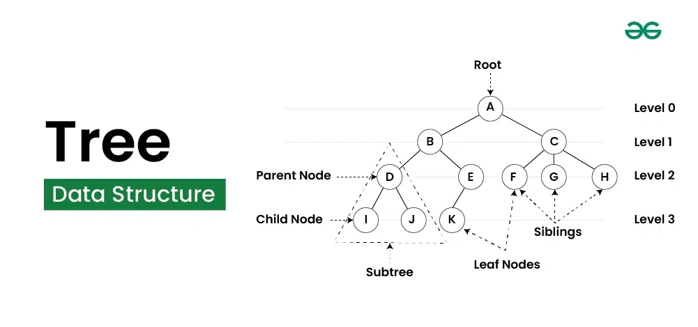
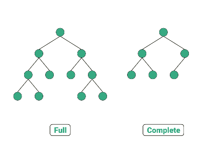
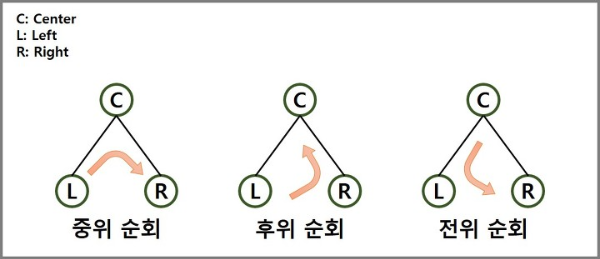

### 1. 트리의 개요

  - 트리 : 계층적 관계를 표현하는 자료구조



  - 노드(node) : 트리의 구성요소 (A\~K)

  - 간선(edge) : 노드와 노드 연결선

  - 루트 노드(root) : 트리 구조 최상위 노드 (A)

  - 단말 노드/잎사귀 노드(terminal, leaf) : 아래로 노드가 연결되어 있지 않은 노드

  - 내부 노드(internal) : 단말 노드를 제외한 모든 노드

  - 레벨(level) : 각 층별로 숫자, 최고 레벨은 높이

 

  - 노드 간에는 부모, 자식, 형제 관계가 성립한다.

 

#### 이진 트리

  - 루트 노드를 중심으로 두 개의 서브 트리

  - 나뉘어진 두 서브 트리도 모두 이진 트리

  - 노드가 위치할 수 있는 곳이 노드가 존재하지 않는다면 공집합 노드가 존재하는 것으로 간주



 

  - 포화 이진 트리(Full) : 모든 레벨이 꽉찬 이진 트리

  - 완전 이진 트리(complete) : 모든 레벨이 꽉 찬 상태는 아니지만, 차곡차곡 빈 틈 없이(위에서 아래로, 왼쪽에서 오른쪽으로) 노드가 채워진 이진 트리

---

### 2. 트리 ADT와 구현

<mark>Operation: </mark>

 

```cpp
BTreeNode * MakeBTreeNode(void);
```

  - 이진 트리 노드를 생성하여 그 주소값 반환

 

```cpp
BTData GetData(BTreeNode * bt);
```

  - 노드에 저장된 데이터 반환

 

```cpp
void SetData(BTreeNode * bt, BTData data);
```

  - 노드에 데이터 저장

 

```cpp
BTreeNode * GetLeftSubTree(BTreeNode * bt);
```

  - 왼쪽 서브 트리의 주소 값 반환

 

```cpp
BTreeNode * GetRightSubTree(BTreeNode * bt);
```

  - 오른쪽 서브 트리의 주소 값 반환

 

```cpp
void MakeLeftSubTree(BTreeNode * main, BTreeNode * sub);
```

  - 왼쪽 서브 트리 연결

  - 이미 존재한다면 삭제 후, 연결

 

```cpp
void MakeRightSubTree(BTreeNode * main, BTreeNode * sub);
```

  - 오른쪽 서브 트리 연결

  - 이미 존재한다면 삭제 후, 연결

 

  - BinaryTree.h

```cpp
#ifndef __BINARY_TREE_H__
#define __BINARY_TREE_H__

typedef int BTData;

typedef struct _bTreeNode{  // 이진 트리 노드 구조체
  BTData data;
  struct _bTreeNode *left;
  struct _bTreeNode *right;
} BTreeNode;

BTreeNode *MakeBTreeNode(void);  // 노드의 생성
BTData GetData(BTreeNode *bt);   // 노드에 저장된 데이터 반환
void SetData(BTreeNode *bt, BTData data);  // 노드에 데이터 저장

BTreeNode *GetLeftSubTree(BTreeNode *bt);   // 왼쪽 서브 트리 주소 반환
BTreeNode *GetRightSubTree(BTreeNode *bt);  // 오른쪽 서브 트리 주소 반환

void MakeLeftSubTree(BTreeNode *main, BTreeNode *sub);  // 왼쪽 서브 트리 연결
void MakeRightSubTree(BTreeNode *main, BTreeNode *sub);  // 오른쪽 서브 트리 연결

#endif
```

 

  - BinaryTree.c

```cpp
#include <stdio.h>
#include <stdlib.h>
#include "BinaryTree.h"

BTreeNode *MakeBTreeNode(void){
  BTreeNode * nd=(BTreeNode *)malloc(sizeof(BTreeNode));
  nd->left=NULL;
  nd->right=NULL;
  return nd;
}

BTData GetData(BTreeNode *bt){
  return bt->data;
}

void SetData(BTreeNode *bt, BTData data){
  bt->data=data;
}

BTreeNode *GetLeftSubTree(BTreeNode *bt){
  return bt->left;
}

BTreeNode *GetRightSubTree(BTreeNode *bt){
  return bt->right;
}

void MakeLeftSubTree(BTreeNode *main, BTreeNode *sub){
  if(main->left!=NULL)
    free(main->left);

  main->left=sub;
}

void MakeRightSubTree(BTreeNode *main, BTreeNode *sub){
  if(main->right!=NULL)
    free(main->right);

  main->right=sub;
}
```

---

### 3. 이진 트리의 순회



 

1\) 전위 순회(Preorder Traversal) : 루트 노드를 먼저

2\) 중위 순회(Inorder Traversal) : 루트 노드를 중간에

3\) 후위 순회(Postorder Traversal) : 루트 노드를 마지막에

 

  - 순회 : 재귀적으로 구현

```cpp
void PreorderTraverse(BTreeNode *bt, VisitFuncPtr action){  // 전위 순회
  if (bt == NULL) {  // bt가 NULL이면 재귀 탈출
    return;
  }
  action(bt->data);
  PreorderTraverse(bt->left, action);
  PreorderTraverse(bt->right, action);
}

void InorderTraverse(BTreeNode *bt, VisitFuncPtr action){  // 중위 순회
  if (bt == NULL) {  // bt가 NULL이면 재귀 탈출
    return;
  }
  InorderTraverse(bt->left, action);
  action(bt->data);
  InorderTraverse(bt->right, action);
}

void PostorderTraverse(BTreeNode *bt, VisitFuncPtr action){  // 후위 순회
  if (bt == NULL) {  // bt가 NULL이면 재귀 탈출
    return;
  }
  PostorderTraverse(bt->left, action);
  PostorderTraverse(bt->right, action);
  action(bt->data);
}
```

 

  - 이진트리의 삭제  : 후위 순회 이용

```cpp
void DeleteTree(BTreeNode *bt){
  if (bt == NULL) {  // bt가 NULL이면 재귀 탈출
    return;
  }
  DeleteTree(bt->left);
  DeleteTree(bt->right);
  free(bt);
}
```

 
