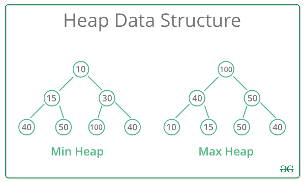

### 1. 힙의 구현

  - 힙 : 완전 이진트리. 루트 노드에 저장된 값(우선순위)이 가장 커야 한다



  - 최소 힙 / 최대 힙

  - 자식 노드 데이터의 우선 순위 ≤ 부모 노드 데이터의 우선 순위

 

  - 힙의 데이터 저장 : 마지막 위치에 데이터 두고, 부모 노드와의 비교를 통해 위치 찾아감.

  - 배열 기반 구현, 인덱스가 0인 요소는 비위 둠

  - 힙에 저장된 노드 개수 = 마지막 노드의 고유번호

 

  - Heap.h

```cpp
#ifndef __USEFUL_HEAP_H__
#define __USEFUL_HEAP_H__

#define TRUE  1
#define FALSE 0

#define HEAP_LEN 100

typedef char HData;
typedef int (*PriorityComp)(HData d1, HData d2);  // 우선순의 판단 기준의 함수 포인터

typedef struct _heap{
  PriorityComp comp;
  int numOfData;
  HData heapArr[HEAP_LEN];
} Heap;

void HeapInit(Heap * ph, PriorityComp pc);
int HIsEmpty(Heap * ph);

void HInsert(Heap * ph, HData data);
HData HDelete(Heap * ph);

#endif
```

 

  - Heap.c

```cpp
#include "UsefulHeap.h"

void HeapInit(Heap * ph, PriorityComp pc){  // 힙의 초기화
  ph->numOfData = 0;
  ph->comp = pc;
}

int HIsEmpty(Heap * ph){  // 힙이 비었는지 확인
  if(ph->numOfData == 0)
    return TRUE;
  else 
    return FALSE;
}

int GetParentIDX(int idx){  // 부모 노드의 인덱스 값 반환
  return idx/2;
}

int GetLChildIDX(int idx){  // 왼쪽 자식 노드의 인덱스 값 반환
  return idx*2;
}

int GetRChildIDX(int idx){  // 오른쪽 자식 노드의 인덱스 값 반환
  return idx*2+1;
}

int GetHiPriChildIDX(Heap * ph, int idx){
  // 자식 노드가 존재하지 않는다면
  if(GetLChildIDX(idx) > ph->numOfData)
    return 0;
  
  // 자식 노드가 왼쪽 자식 노드 하나만 존재한다면
  else if(GetLChildIDX(idx) == ph->numOfData)
    return GetLChildIDX(idx);
  
  // 자식 노드가 둘 다 존재한다면
  else{
    // 우선순위 비교
    if(ph->comp(ph->heapArr[GetLChildIDX(idx)], ph->heapArr[GetRChildIDX(idx)]) < 0)
      return GetRChildIDX(idx);  // 오른쪽 자식 노드의 인덱스 값 반환
    else
      return GetLChildIDX(idx); // 왼쪽 자식 노드의 인덱스 값 반환
  }
}

void HInsert(Heap * ph, HData data){
  int idx = ph->numOfData+1;

  while(idx != 1){
    if(ph->comp(data, ph->heapArr[GetParentIDX(idx)]) > 0){
      ph->heapArr[idx] = ph->heapArr[GetParentIDX(idx)];
      idx = GetParentIDX(idx);
    }
    else
      break;
  }
  ph->heapArr[idx] = data;
  ph->numOfData += 1;
}

HData HDelete(Heap * ph){
  HData retData = ph->heapArr[1];
  HData lastElem = ph->heapArr[ph->numOfData];

  int parentIdx = 1;
  int childIdx;

  while((childIdx = GetHiPriChildIDX(ph, parentIdx))){
    if(ph->comp(lastElem, ph->heapArr[childIdx]) >= 0)
      break;

    ph->heapArr[parentIdx] = ph->heapArr[childIdx];
    parentIdx = childIdx;
  }

  ph->heapArr[parentIdx] = lastElem;
  ph->numOfData -= 1;
  return retData;
}
```

---

### 2. 우선순위 큐 ADT와 구현

  - 우선순위 큐 : 들어간 순서에 상관 없이 우선 순위가 높은 데이터가 먼저 나옴

<mark>Operation :</mark>

```cpp
void PQueueInit(PQueue * ppq, PriorityComp pc);
```

  - 우선순위 큐의 초기화

  - 우선순위 큐 생성 후 가장 먼저 호출

 

```cpp
int PQIsEmpty(PQueue * ppq);
```

  - 우선순위 큐가 빈 경우 TRUE(1), 그렇지 않은 경우 FALSE(0) 반환

 

```cpp
void PEnqueue(PQueue * ppq, PQData data);
```

  - 우선순위 큐에 데이터 저장

 

```cpp
PQData PDequeue(PQueue * ppq);
```

  - 우선순위 가장 높은 데이터 삭제. 삭제된 데이터 반환

  - 데이터가 하나 이상 존재함 보장

 

  - 힙 자료구조 이용한 구현

  - PriorityQueue.h

```cpp
#ifndef __PRIORITY_QUEUE_H__
#define __PRIORITY_QUEUE_H__

#include "UsefulHeap.h"

typedef Heap PQueue;
typedef HData PQData;

void PQueueInit(PQueue * ppq, PriorityComp pc);
int PQIsEmpty(PQueue * ppq);

void PEnqueue(PQueue * ppq, PQData data);
PQData PDequeue(PQueue * ppq);

#endif
```

 

  - PriorityQueue.c

```cpp
#include "PriorityQueue.h"
#include "UsefulHeap.c"
#include "UsefulHeap.h"

void PQueueInit(PQueue * ppq, PriorityComp pc){
  HeapInit(ppq, pc);
}

int PQIsEmpty(PQueue * ppq){
  return HIsEmpty(ppq);
}

void PEnqueue(PQueue * ppq, PQData data){
  HInsert(ppq, data);
}

PQData PDequeue(PQueue * ppq){
  return HDelete(ppq);
}
```
