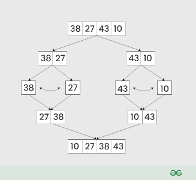
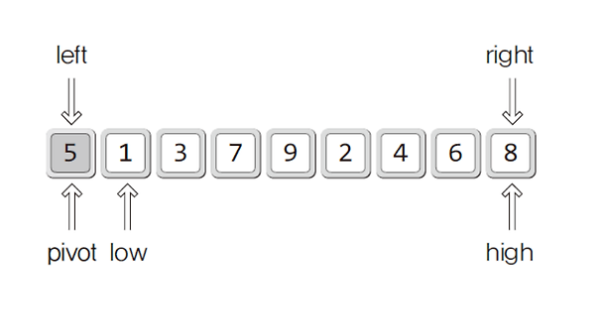
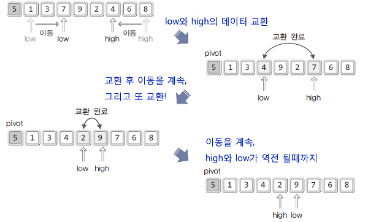
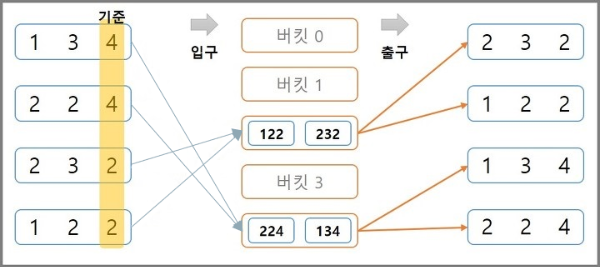

### 1. 단순 정렬 알고리즘

  - 정렬 알고리즘의 성능 : 비교의 횟수 / 이동의 횟수

1\) 버블 정렬 (Bubble Sort)

```cpp
void BubbleSort(int arr[], int n){
  int i, j;
  int temp;

  for(i = 0; i < n - 1; i++){
    for(j = 0; j < (n - i) - 1; j++){
      if(arr[j] > arr[j + 1]){
        // 데이터의 교환
        temp = arr[j];
        arr[j] = arr[j + 1];
        arr[j + 1] = temp;
      }
    }
  }
}
```

  - 빅-오 표기법으로 보는 성능

<table>
<tbody>
<tr>
<td>비교 연산 횟수 </td>
<td>O(n²)</td>
</tr>
<tr>
<td>이동 연산 횟수</td>
<td>O(n²)</td>
</tr>
</tbody>
</table>

 

2\) 선택 정렬 (Selection Sort)

```cpp
void SelectionSort(int arr[], int n){
  int i, j;
  int maxIdx;
  int temp;

  for(i = 0; i < n - 1; i++){
    maxIdx = i;
    for(j = i + 1; j < n; j++){  // 최솟값 탐색
      if(arr[j] < arr[maxIdx])
        maxIdx = j;
    }

    // 교환
    temp = arr[i];
    arr[i] = arr[maxIdx];
    arr[maxIdx] = temp;
  }
}
```

  - 빅-오 표기법으로 보는 성능

<table>
<tbody>
<tr>
<td>비교 연산 횟수</td>
<td>O(n²)</td>
</tr>
<tr>
<td>이동 연산 횟수</td>
<td>O(n)</td>
</tr>
</tbody>
</table>

 

3\) 삽입 정렬 (Insertion Sort)

```cpp
void InsertionSort(int arr[], int n){
  int i, j;
  int insData;

  for(i = 1; i < n; i++){
    insData = arr[i];  // 정렬 대상을 insData에 저장
    for(j = i - 1; j >= 0; j--){
      if(arr[j] > insData)  // 정렬된 데이터가 크다면
        arr[j + 1] = arr[j];  // 비교 대상 한 칸 뒤로 이동
      else
        break;  // 삽입 위치 찾았으므로 탈출
    }

    arr[j + 1] = insData;  // 찾은 위치에 정렬 대상 삽입
  }
}
```

  - 빅-오 표기법으로 보는 성능

<table>
<tbody>
<tr>
<td>비교 연산 횟수</td>
<td>O(n²)</td>
</tr>
<tr>
<td>이동 연산 횟수</td>
<td>O(n²)</td>
</tr>
</tbody>
</table>

---

### 2. 복잡하지만 효율적인 정렬 알고리즘

1\) 힙 정렬 (Heap Sort)

```cpp
void HeapSort(int arr[], int n, PriorityComp pc){
  Heap heap;
  int i;

  HeapInit(&heap, pc);

  // 정렬대상 통해 힙 구성
  for(i = 0; i < n; i++)
    HInsert(&heap, arr[i]);

  // 순서대로 하나씩 꺼내서 정렬 완성
  for(i = 0; i < n; i++)
    arr[i] = HDelete(&heap);
}
```

  - 시간 복잡도 : O(nlog₂n)

 

2\) 병합 정렬 (Merge Sort)

  - 분할 정복 기법 근거 : 분할 / 정복 / 결합



```cpp
void MergeTwoArea(int arr[], int left, int mid, int right){
  int fIdx = left;
  int rIdx = mid + 1;
  int i;

  // 병합 한 결과를 담을 배열 sortArr 동적 할당
  int *sortArr = (int*)malloc(sizeof(int) * (right + 1));
  int sIdx = left;

  while(fIdx <= mid && rIdx <= right){  // 병합할 두 영역의 데이터 비교
    if(arr[fIdx] <= arr[rIdx])
      sortArr[sIdx] = arr[fIdx++];
    else
      sortArr[sIdx] = arr[rIdx++];

    sIdx++;
  }

  if(fIdx > mid){  // 배열의 앞 부분이 모두 옮겨지면, 나머지 데이터를 그대로 복사
    for(i = rIdx; i <= right; i++, sIdx++)
      sortArr[sIdx] = arr[i];
  } else{  // 배열의 뒷 부분이 모두 옮겨지면, 나머지 데이터를 그대로 복사
    for(i = fIdx; i <= mid; i++, sIdx++)
      sortArr[sIdx] = arr[i];
  }

  for(i = left; i <= right; i++)
    arr[i] = sortArr[i];

  free(sortArr);
}

void MergeSort(int arr[], int left, int right){
  int mid;

  if(left < right){
    // 중간 지점 계산
    mid = (left + right) / 2;

    // 둘로 나눠서 각각을 정렬
    MergeSort(arr, left, mid);
    MergeSort(arr, mid + 1, right);

    // 정렬된 두 배열을 병합
    MergeTwoArea(arr, left, mid, right);
  }
}
```

  - 시간 복잡도 : O(nlog₂n)

 

3\) 퀵 정렬 (Quick Sort)



  - left : 정렬대상의 가장 왼쪽 지점

  - right : 정렬대상의 가장 오른쪽 지점

  - pivot : 중심점, 중심축(위치 상관 X)

  - low : 피벗 제외, 가장 왼쪽 지점

  - high : 피벗 제외, 가장 오른쪽 지점



```cpp
void Swap(int arr[], int idx1, int idx2){
  int temp = arr[idx1];
  arr[idx1] = arr[idx2];
  arr[idx2] = temp;
}

int Partition(int arr[], int left, int right){
  int pivot = arr[left];  // 피벗은 첫 번째 요소
  int low = left + 1;
  int high = right;

  while(low <= high){  // 교차되기 전까지 반복
    // 피벗보다 큰 값을 찾는 과정
    while(pivot >= arr[low] && low <= right)
      low++;  // low 오른쪽 이동

    // 피벗보다 작은 값을 찾는 과정
    while(pivot <= arr[high] && high >= (left + 1))
      high--; // high 왼쪽 이동

    // 교차되지 않은 상태라면
    if(low <= high)
      Swap(arr, low, high);  // Swap 실행
  }

  Swap(arr, left, high);  // 피벗과 작은 데이터 교환
  return high;  // 옮겨진 피벗의 위치정보 반환
}

void QuickSort(int arr[], int left, int right){
  if(left<=right){
    int pivot = Partition(arr, left, right);  // 둘로 나눠서
    QuickSort(arr, left, pivot - 1);  // 왼쪽 영역을 정렬
    QuickSort(arr, pivot + 1, right);  // 오른쪽 영역을 정렬
  }
}
```

 

  - 중간에 가까운 피벗일 수록 성능 증가

  - 시간 복잡도 : O(nlog₂n), 동일한 빅-오를 갖는 정렬 알고리즘 중 평균적으로 가장 빠른 정렬 속도.

 

4\) 기수 정렬 

  - 가장 빠른 정렬 알고리즘

  - 길이가 같은 데이터를 데상으로만 정렬 가능



```cpp
void RadixSort(int arr[], int num, int maxLen){
  // 매개변수 maxLen에는 정렬할 데이터 중 가장 긴 데이터의 길이 정보가 전달
  Queue buckets[BUCKET_NUM];
  int bi;
  int pos;
  int di;
  int radix;
  int divfac = 1;

  // 버킷 초기화
  for(bi = 0; bi < BUCKET_NUM; bi++)
    QueueInit(&buckets[bi]);
  
  // 가장 긴 데이터의 길이만큼 반복
  for(pos=0; pos<maxLen; pos++){
    // 정렬 대상의 수만큼 반복
    for(di=0; di<num; di++){
      // N번째 자리의 숫자 추출
      radix = (arr[di] / divfac) % 10;
      // 추출한 숫자를 근거로 버킷에 데이터 저장
      Enqueue(&buckets[radix], arr[di]);
    }

    // 버킷 수만큼 반복
    for(bi=0, di=0; bi<BUCKET_NUM; bi++){
      // 버킷에 저장된 것 순서대로 다 꺼내서 다시 arr에 저장
      while(!QIsEmpty(&buckets[bi]))
        arr[di++] = Dequeue(&buckets[bi]);
    }
    // N번째 자리의 숫자 추출을 위한 피제수 증가
    divfac *= 10;
  }
}
```

  - 시간 복잡도 : O(n)
