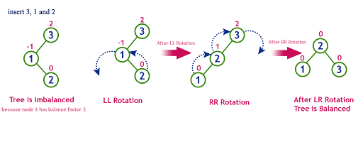

### 1. 탐색

  - 데이터를 찾는 방법

  - 순차 탐색 (Linear Search) : 정렬되지 않은 대상을 기반으로 하는 탐색

```cpp
int LSearch(int ar[], int len, int target){
  int i;
  for(i=0; i<len; i++){
    if(ar[i] == target)
      return i;  // 찾은 대상의 인덱스 값 반환
  }
  return -1;  // 찾지 못했음을 의미하는 값 반환
}
```

  - 시간 복잡도 : O(n)

 

  - 이진 탐색 (Binary Search) : 정렬된 대상을 기반으로 하는 탐색, 중앙에서 탐색 시작

```cpp
int BSearchRecur(int ar[], int first, int last, int target){
  int mid;
  if(first > last)
    return -1;

  mid = (first + last) / 2;

  if(ar[mid] == target)
    return mid;
  else if(target < ar[mid])
    return BSearchRecur(ar, first, mid-1, target);
  else
    return BSearchRecur(ar, mid+1, last, target);
}
```

  - 시간 복잡도 : O(log₂n)

 

  - 보간 탐색 (Interpolation Search) : 정렬된 대상을 기반으로 하는 탐색, 탐색 대상의 위치에서 탐색 시작

```cpp
int ISearch(int ar[], int first, int last, int target){
  int mid;

  if(ar[first] > target || ar[last] < target)
    return -1;  // 탐색의 실패

  // 이진 탐색과의 차이점
  mid = ((double)(target - ar[first]) / (ar[last] - ar[first]) * (last - first)) + first;

  if(ar[mid] == target)
    return mid;  // 탐색된 타겟의 인덱스 값 반환
  else if(target < ar[mid])
    return ISearch(ar, first, mid-1, target);
  else
    return ISearch(ar, mid+1, last, target);
}
```

  - 시간 복잡도 : O(log(logn))

---

### 2. 이진 탐색 트리

  - 이진 트리 + 데이터 저장 규칙

  - 왼쪽 자식 노드의 키 < 부모 노드의 키 < 오른쪽 자식 노드의 키

 

  - 이진 트리.h

```cpp
#ifndef __BINARY_TREE_H__
#define __BINARY_TREE_H__

typedef int BTData;

typedef struct _bTreeNode {
    BTData data;
    struct _bTreeNode *left;
    struct _bTreeNode *right;
} BTreeNode;

BTreeNode* MakeBTreeNode(void);
BTData GetData(BTreeNode *bt);
void SetData(BTreeNode *bt, BTData data);

BTreeNode* GetLeftSubTree(BTreeNode *bt);
BTreeNode* GetRightSubTree(BTreeNode *bt);

void MakeLeftSubTree(BTreeNode *main, BTreeNode *sub);
void MakeRightSubTree(BTreeNode *main, BTreeNode *sub);

typedef void (*VisitFuncPtr)(BTData data);

void PreorderTraverse(BTreeNode *bt, VisitFuncPtr action);
void InorderTraverse(BTreeNode *bt, VisitFuncPtr action);
void PostorderTraverse(BTreeNode *bt, VisitFuncPtr action);

BTreeNode * RemoveLeftSubTree(BTreeNode *bt);
BTreeNode * RemoveRightSubTree(BTreeNode *bt);
void ChangeLeftSubTree(BTreeNode *main, BTreeNode *sub);
void ChangeRightSubTree(BTreeNode *main, BTreeNode *sub);

void DeleteTree(BTreeNode *bt);

#endif
```

 

  - 이진 트리.c

```cpp
#include <stdio.h>
#include <stdlib.h>
#include "BinaryTree.h"

BTreeNode *MakeBTreeNode(void){
  BTreeNode * nd=(BTreeNode *)malloc(sizeof(BTreeNode));
  nd->left=NULL;
  nd->right=NULL;
  return nd;
}

BTData GetData(BTreeNode *bt){
  return bt->data;
}

void SetData(BTreeNode *bt, BTData data){
  bt->data=data;
}

BTreeNode *GetLeftSubTree(BTreeNode *bt){
  return bt->left;
}

BTreeNode *GetRightSubTree(BTreeNode *bt){
  return bt->right;
}

void MakeLeftSubTree(BTreeNode *main, BTreeNode *sub){
  if(main->left!=NULL)
    free(main->left);

  main->left=sub;
}

void MakeRightSubTree(BTreeNode *main, BTreeNode *sub){
  if(main->right!=NULL)
    free(main->right);

  main->right=sub;
}

void PreorderTraverse(BTreeNode *bt, VisitFuncPtr action){
  if (bt == NULL) {  // bt가 NULL이면 재귀 탈출
    return;
  }
  action(bt->data);
  PreorderTraverse(bt->left, action);
  PreorderTraverse(bt->right, action);
}

void InorderTraverse(BTreeNode *bt, VisitFuncPtr action){
  if (bt == NULL) {  // bt가 NULL이면 재귀 탈출
    return;
  }
  InorderTraverse(bt->left, action);
  action(bt->data);
  InorderTraverse(bt->right, action);
}

void PostorderTraverse(BTreeNode *bt, VisitFuncPtr action){
  if (bt == NULL) {  // bt가 NULL이면 재귀 탈출
    return;
  }
  PostorderTraverse(bt->left, action);
  PostorderTraverse(bt->right, action);
  action(bt->data);
}

BTreeNode * RemoveLeftSubTree(BTreeNode *bt){
  BTreeNode * delNode;
  if(bt!=NULL){
    delNode=bt->left;
    bt->left=NULL;
  }
  return delNode;
}

BTreeNode * RemoveRightSubTree(BTreeNode *bt){
  BTreeNode * delNode;
  if(bt!=NULL){
    delNode=bt->right;
    bt->right=NULL;
  }
  return delNode;
}

void ChangeLeftSubTree(BTreeNode *main, BTreeNode *sub){
  main->left=sub;
}

void ChangeRightSubTree(BTreeNode *main, BTreeNode *sub){
  main->right=sub;
}

void DeleteTree(BTreeNode *bt){
  if (bt == NULL) {  // bt가 NULL이면 재귀 탈출
    return;
  }
  DeleteTree(bt->left);
  DeleteTree(bt->right);
  free(bt);
}
```

 

 

  - 이진 탐색 트리.h

```cpp
#ifndef __BINARY_SEARCH_TREE_H__
#define __BINARY_SEARCH_TREE_H__

#include "BinaryTree.h"

typedef BTData BSTData;

// BST의 생성 및 초기화
void BSTMakeAndInit(BTreeNode ** pRoot);

// 노드에 저장된 데이터 반환
BSTData BSTGetNodeData(BTreeNode * bst);

// BST를 대상으로 데이터 저장(노드의 생성과정 포함)
void BSTInsert(BTreeNode ** pRoot, BSTData data);

// BST를 대상으로 데이터 탐색
BTreeNode * BSTSearch(BTreeNode * bst, BSTData target);

// 트리에서 노드를 삭제하고 삭제된 노드의 주소 값을 반환한다.
BTreeNode * BSTRemove(BTreeNode ** pRoot, BSTData target);

// 이진 탐색 트리에 저장된 모든 노드의 데이터를 출력한다.
void BSTShowAll(BTreeNode * bst);

#endif
```

 

  - 이진 탐색 트리.c

```cpp
#include <stdio.h>
#include <stdlib.h>
#include "BinarySearchTree.h"
#include "BinaryTree.h"
#include "BinaryTree.c"

void BSTMakeAndInit(BTreeNode ** pRoot){
  *pRoot=NULL;
}

BSTData BSTGetNodeData(BTreeNode * bst){
  return GetData(bst);
}

void BSTInsert(BTreeNode ** pRoot, BSTData data){
  BTreeNode * pNode=NULL;    // parent node
  BTreeNode * cNode=*pRoot;  // current node
  BTreeNode * nNode=NULL;    // new node

  // 새로운 노드가(새 데이터가 담긴 노드가) 추가될 위치를 찾는다.
  while(cNode!=NULL){
    if(data==GetData(cNode))
      return;  // 데이터의(키의) 중복을 허용하지 않음

    pNode=cNode;

    if(GetData(cNode)>data)
      cNode=GetLeftSubTree(cNode);
    else
      cNode=GetRightSubTree(cNode);
  }

  // pNode의 자식 노드로 추가할 새 노드의 생성
  nNode=MakeBTreeNode();  // 새 노드 생성
  SetData(nNode, data);   // 새 노드에 데이터 저장

  // pNode의 자식 노드로 새 노드를 추가
  if(pNode!=NULL){           // 새 노드가 루트 노드가 아니라면
    if(data<GetData(pNode))
      MakeLeftSubTree(pNode, nNode);
    else
      MakeRightSubTree(pNode, nNode);
  } 
  else  // 새 노드가 루트 노드라면
    *pRoot=nNode;  // pNode가 NULL이면 루트 노드에 새 노드를 추가
}

BTreeNode * BSTSearch(BTreeNode * bst, BSTData target){
  BTreeNode * cNode=bst;  // current node
  BSTData cd;             // current data

  while(cNode!=NULL){
    cd=GetData(cNode);

    if(target==cd)
      return cNode;
    else if(target<cd)
      cNode=GetLeftSubTree(cNode);
    else
      cNode=GetRightSubTree(cNode);
  }

  return NULL;  // 탐색 대상이 저장되어 있지 않음
}

BTreeNode * BSTRemove(BTreeNode ** pRoot, BSTData target){
  // 삭제 대상이 루트 노드인 경우를 별도로 고려해야 한다.
  BTreeNode * pVRoot=MakeBTreeNode();  // 가상 루트 노드
  BTreeNode * pNode=pVRoot;            // parent node
  BTreeNode * cNode=*pRoot;            // current node
  BTreeNode * dNode;                   // delete node

  // 루트 노드를 pVRoot가 가리키는 노드의 오른쪽 자식이 되게 한다.
  ChangeRightSubTree(pVRoot, *pRoot);

  // 삭제 대상을 탐색
  while(cNode!=NULL && GetData(cNode)!=target){
    pNode=cNode;

    if(target<GetData(cNode))
      cNode=GetLeftSubTree(cNode);
    else
      cNode=GetRightSubTree(cNode);
  }

  // 삭제 대상이 존재하지 않는다면
  if(cNode==NULL)
    return NULL;

  dNode=cNode;  // 삭제 대상을 dNode가 가리키게 한다.

  // 첫 번째 경우: 단말 노드 삭제
  if(GetLeftSubTree(dNode)==NULL && GetRightSubTree(dNode)==NULL){
    if(GetLeftSubTree(pNode)==dNode)
      RemoveLeftSubTree(pNode);
    else
      RemoveRightSubTree(pNode);
  }
  // 두 번째 경우: 자식이 하나인 노드 삭제
  else if(GetLeftSubTree(dNode)==NULL || GetRightSubTree(dNode)==NULL){
    BTreeNode * dcNode;

    if(GetLeftSubTree(dNode)!=NULL)
      dcNode=GetLeftSubTree(dNode);
    else
      dcNode=GetRightSubTree(dNode);

    if(GetLeftSubTree(pNode)==dNode)
      ChangeLeftSubTree(pNode, dcNode);
    else
      ChangeRightSubTree(pNode, dcNode);
  }
  // 세 번째 경우: 자식이 두 개인 노드 삭제
  else{
    BTreeNode * mNode=dNode->right;  // 대체 노드 가리킴
    BTreeNode * mpNode=dNode;        // 대체 노드의 부모 노드 가리킴
    int delData;

    // 삭제 대상의 대체 노드를 찾는다.
    while(GetLeftSubTree(mNode)!=NULL){
      mpNode=mNode;
      mNode=GetLeftSubTree(mNode);
    }

    // 대체 노드에 저장된 값을 삭제할 노드에 대입한다.
    delData=GetData(dNode);  // 대입 전 데이터 백업
    SetData(dNode, GetData(mNode));  // 대입

    // 대체 노드의 부모 노드와 자식 노드를 연결한다.
    if(GetLeftSubTree(mpNode)==mNode)
      ChangeLeftSubTree(mpNode, GetRightSubTree(mNode));
    else
      ChangeRightSubTree(mpNode, GetRightSubTree(mNode));

    dNode=mNode;
    SetData(dNode, delData);  // 백업 데이터 복원
  }

  // 삭제된 노드가 루트 노드인 경우에 대한 추가적인 처리
  if(GetRightSubTree(pVRoot)!=*pRoot)
    *pRoot=GetRightSubTree(pVRoot);  // 루트 노드가 변경됨
  free(pVRoot);  // 가상 루트 노드의 소멸
  return dNode;
}

void ShowIntData(int data){
  printf("%d ", data);
}

void BSTShowAll(BTreeNode * bst){
  InorderTraverse(bst, ShowIntData);
}
```

 

  - 시간 복잡도 : O(log₂n)

---

### 3. AVL 트리

  - 균형 잡힌 이진트리 

  - 균형 인수 : 왼쪽 서브 트리의 높이 - 오른쪽 서브 트리의 높이

 



 

  - 헤더 파일

```cpp
#ifndef __AVL_REBALANCE_H__
#define __AVL_REBALANCE_H__

#include "BinaryTree3.h"

// 트리의 균형을 잡는다
BTreeNode * Rebalance(BTreeNode ** pRoot);

#endif
```

 

  - 소스 파일

```cpp
#include <stdio.h>
#include "BinaryTree3.h"
#include "AVLRebalance.h"

int GetHeight(BTreeNode * bst){
  int leftH, rightH;

  if(bst==NULL)
    return 0;

  leftH=GetHeight(GetLeftSubTree(bst));
  rightH=GetHeight(GetRightSubTree(bst));

  // 큰 값의 높이 반환
  if(leftH>rightH)
    return leftH+1;
  else
    return rightH+1;
}

int GetHeightDiff(BTreeNode * bst){
  int lsh, rsh;

  if(bst==NULL)
    return 0;

  lsh=GetHeight(GetLeftSubTree(bst));
  rsh=GetHeight(GetRightSubTree(bst));

  return lsh-rsh;  // 균형 인수 계산 결과
}

BTreeNode * RotateLL(BTreeNode * bst){
  BTreeNode * pNode;  // parent node
  BTreeNode * cNode;  // child node

  // 노드의 교환을 위한 포인터 설정
  pNode=bst;
  cNode=GetLeftSubTree(pNode);

  // 회전
  ChangeLeftSubTree(pNode, GetRightSubTree(cNode));
  ChangeRightSubTree(cNode, pNode);

  return cNode;  // 새로운 루트 노드 주소 반환
}

BTreeNode * RotateRR(BTreeNode * bst){
  BTreeNode * pNode;  // parent node
  BTreeNode * cNode;  // child node

  // 노드의 교환을 위한 포인터 설정
  pNode=bst;
  cNode=GetRightSubTree(pNode);

  // 회전
  ChangeRightSubTree(pNode, GetLeftSubTree(cNode));
  ChangeLeftSubTree(cNode, pNode);

  return cNode;  // 새로운 루트 노드 주소 반환
}

BTreeNode * RotateLR(BTreeNode * bst){
  BTreeNode * pNode;  // parent node
  BTreeNode * cNode;  // child node

  // 노드의 교환을 위한 포인터 설정
  pNode=bst;
  cNode=GetLeftSubTree(pNode);

  // 회전
  ChangeLeftSubTree(pNode, RotateRR(cNode));  // 부분적 RR 회전

  return RotateLL(pNode);  // LL 회전
}

BTreeNode * RotateRL(BTreeNode * bst){
  BTreeNode * pNode;  // parent node
  BTreeNode * cNode;  // child node

  // 노드의 교환을 위한 포인터 설정
  pNode=bst;
  cNode=GetRightSubTree(pNode);

  // 회전
  ChangeRightSubTree(pNode, RotateLL(cNode));  // 부분적 LL 회전
  return RotateRR(pNode);  // RR 회전
}

BTreeNode * Rebalance(BTreeNode ** pRoot){
  int hDiff=GetHeightDiff(*pRoot);  // 균형 인수 계산

  if(hDiff>1){  // 균형 인수가 2 이상이면 LL / LR
    if(GetHeightDiff(GetLeftSubTree(*pRoot))>0)
      *pRoot=RotateLL(*pRoot);
    else
      *pRoot=RotateLR(*pRoot);
  }

  if(hDiff<-1){  // 균형 인수가 2 이하이면 RR / RL
    if(GetHeightDiff(GetRightSubTree(*pRoot))<0)
      *pRoot=RotateRR(*pRoot);
    else
      *pRoot=RotateRL(*pRoot);
  }

  return *pRoot;
}
```
