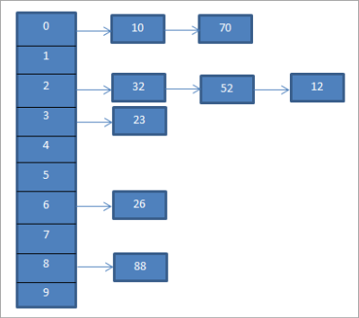

### 1. 해쉬 테이블

  - 키 : 값

  - 키는 중복되지 않는다

  - 테이블 = 딕셔너리 = 맵

  - [[시간 복잡도]] : O(1)

 

  - 해쉬 함수 : 넓은 범위의 키를 좁은 범위의 키로 변경

  - [[Collision|충돌]]의 문제 발생 가능

 

  - Table.h

```cpp
#ifndef __TABLE_H__
#define __TABLE_H__

#include "Slot.h"

#define MAX_TBL 100

typedef int HashFunc(Key k);

typedef struct _table {
    Slot tbl[MAX_TBL];
    HashFunc* hf;
} Table;

// 테이블의 초기화
void TBLInit(Table * pt, HashFunc f);

// 테이블에 키와 값을 저장
void TBLInsert(Table * pt, Key k, Value v);

// 키를 근거로 테이블에서 데이터 삭제
Value TBLDelete(Table * pt, Key k);

// 키를 근거로 테이블에서 데이터 탐색
Value TBLSearch(Table * pt, Key k);

#endif
```

 

 

  - Table.c

```cpp
#include <stdio.h>
#include <stdlib.h>
#include "Table.h"

void TBLInit(Table * pt, HashFunc * f){
  int i;

  // 모든 슬롯 초기화
  for(i=0; i<MAX_TBL; i++){
    (pt->tbl[i]).status=EMPTY;
  }
  pt->hf=f;  // 해쉬 함수 등록
}

void TBLInsert(Table * pt, Key k, Value v){
  int hv=pt->hf(k);  // 키를 해쉬 함수로 변환
  pt->tbl[hv].val=v;  // 해쉬 값에 대응하는 슬롯에 저장
  pt->tbl[hv].key=k;  // 해쉬 값에 대응하는 슬롯에 저장
  pt->tbl[hv].status=INUSE;  // 해쉬 값에 대응하는 슬롯에 저장
}

Value TBLDelete(Table * pt, Key k){
  int hv=pt->hf(k);  // 키를 해쉬 함수로 변환

  if((pt->tbl[hv]).status!=INUSE){
    return NULL;
  } else {
    (pt->tbl[hv]).status=DELETED;
    return (pt->tbl[hv]).val;  // 삭제된 데이터 반환
  }
}

Value TBLSearch(Table * pt, Key k){
  int hv=pt->hf(k);  // 키를 해쉬 함수로 변환

  if((pt->tbl[hv]).status!=INUSE){
    return NULL;
  } else {
    return (pt->tbl[hv]).val;  // 탐색된 데이터 반환
  }
}
```

 

  - 해쉬 함수의 디자인

  1) 자릿수 선택 : 여러 자리 중 해쉬 값 생성에 도움을 주는 자리만 뽑아 해쉬 값 생성

  2) 자릿수 폴딩 : 자릿수를 나눠 나눈 수끼리 더한 값을 해쉬 값으로 함

---

### 2. 충돌 문제 해결책

#### 1) 선형 조사법 & 이차 조사법

  - 선형 조사법 : 충돌이 발생했을 때 옆자리가 비었는지 살펴보고 비었을 경우 그 자리에 대신 저장

> f(k)+1 → f(k)+2 → f(k)+3 → f(k)+4 

 

  - 클러스터 현상(특정 영역에 데이터가 집중적으로 몰리는 현상) : 발생 

 

  - 이차 조사법 : n²칸 옆의 슬롯을 검사

> f(k)+1² → f(k)+2² → f(k)+3² → f(k)+4²

 

  - 데이터가 삭제된 슬롯의 상태 정보를 Deleted로 두어 탐색과정에서 충돌 의심해야 함

 

#### 2) 이중 해쉬

  - 두 가지의 해쉬 함수 사용

> 1차 해쉬 함수 : 키를 근거로 저장 위치 결정\
> 2차 해쉬 함수 : 충돌 발생시 몇 칸 뒤를 살필지 결정

 

  - 2차 해쉬 함수 결정 일반 형태 

> h2(k) = 1 + (k % c)   \
> \# c 는 소수

  - 2차 해쉬 값이 0이 되는 것을 막기 위해 1 더함

  - 일반적으로 소수를 선택했을 때 클러스터 현상의 발생 확률 낮춤

  - 1차 해쉬 값보다 2차 해쉬 값이 낮도록 나눔

 

#### 3) 체이닝

  - 닫힌 어드레싱 방법 : 무슨 일이 있어도 자신의 자리에 저장 

  - [[Linked List|연결 리스트]] 이용



  - 하나의 해쉬 값에 다수의 슬롯 가능

 

  - 체이닝의 구현을 위한 두 가지 방법

> ▶ 슬롯이 연결 리스트의 노드 역할을 하게 하는 방법\
> ▶ 연결 리스트의 노드와 슬롯을 구분하는 방법
