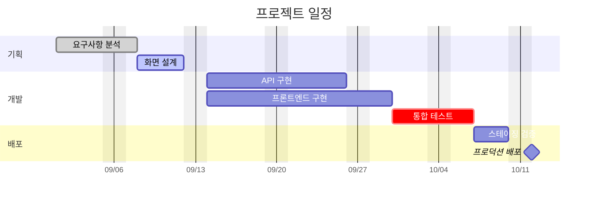

- 작업(task)의 ==기간과 선후 의존 관계== 가로 막대로 표현하는 일정 관리 [[다이어그램]]
- 선언 키워드 `gantt`

### 형태
- 헤더 설정
	- `dateFormat` : 입력 날짜 형식, ==ex)== `YYYY-MM-DD`
	- `axisFormat` : 화면 표시 축 형식, ==ex)== `%m/%d`
	- `excludes weekends` : 주말 기간 계산 제외
- 작업 문법 : `작업명 :태그, ID, 시작일, 기간`
	- 시작일 대신 `after 다른작업ID` -> 의존 관계 지정 O
- `section` 으로 작업 그룹핑

### 종류
- [[state|상태]] 태그
	- `done` : 완료
	- `active` : 진행 중
	- `crit` : [[크리티컬 패스]]
	- `milestone` : 0일 지점

### 특징
- 프로젝트 각 작업 시작 & 종료 일정 막대 도표로 표시 -> ==시간선(Time-Line) 차트==
- 이정표 · 작업 일정 · 작업 기간 · 산출물 구성
	- 수평 막대 길이 = 각 작업(Task) 기간
- 중간 목표 미달성 -> 이유 · 기간 예측 O
- 사용자와 문제점 · 예산 초과 지출 관리
- 자원 [[배치 처리|배치]] & 인원 계획 유용
- [[CPM]] [[컴퓨터 네트워크|네트워크]] [[데이터]] 바탕 제작
- 작업 경로 표시 X, 계획 변화 적응성 弱
- 계획 수립 or 수정 시 주관적 수치에 기울어지기 쉬움

![[소프트웨어-개발-방법론-활용-05.png]]

### 예시

### 활용
- 팀 프로젝트 계획서에 마일스톤 · 데드라인 명시
- 병렬 · 순차 작업 섞인 일정에서 [[크리티컬 패스]] 도출
- [[스프린트]] 회고에서 계획 대비 실제 소요 기간 비교
- 졸업 프로젝트 중간 발표 자료 진척도 시각화

### 참고
- https://mermaid.js.org/syntax/gantt.html
